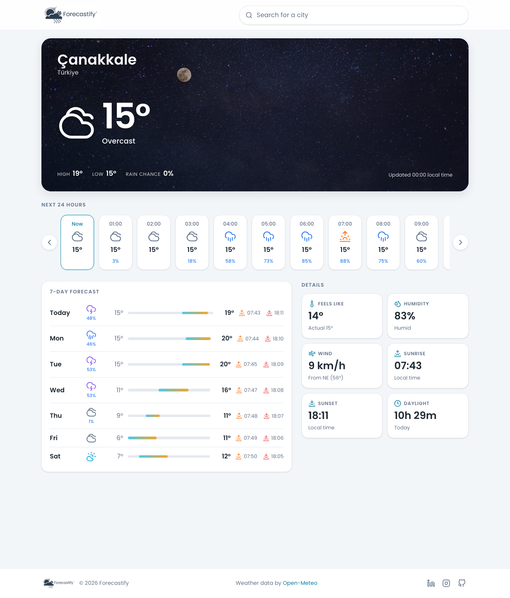

# Forecastify – Weather App

Forecastify is a React weather app that shows the current conditions, the next 24 hours and a 7-day outlook for any city in the world. Forecast data comes from the free [Open-Meteo](https://open-meteo.com/) API and the search box is powered by Open-Meteo's geocoding API.



## Features

- City search with debounced auto-complete, keyboard navigation (↑ ↓ Enter Esc) and region/country disambiguation
- Current conditions on a background that follows the weather and the time of day
- 24-hour strip with temperature, precipitation chance and sunrise/sunset markers
- 7-day forecast with min/max temperatures drawn on a weekly temperature range bar
- Detail cards: feels like, humidity, wind (speed + compass direction), sunrise, sunset, daylight duration
- Remembers the last searched city between visits
- Loading, error and retry states; stale requests are cancelled when the city changes
- Responsive, mobile-first layout

## Tech stack

- [React 19](https://react.dev/) + [Vite 8](https://vite.dev/)
- [Sass](https://sass-lang.com/) (SCSS partials, one per UI area)
- [Axios](https://axios-http.com/) for HTTP, [lucide-react](https://lucide.dev/) for icons
- ESLint (flat config) with the `react-hooks` and `react-refresh` plugins

## Getting started

Requires Node.js 20.19+ (or 22.12+).

```bash
npm install
npm run dev       # http://localhost:5173
npm run build     # production build → build/
npm run preview   # serve the production build locally
npm run lint
```

## Project structure

```
src/
  components/   UI components (Header, SearchBar, CurrentWeather, HourlyForecast,
                DailyForecast, DetailCards, Feedback, Footer)
  context/      WeatherContext + WeatherProvider (selected city, forecast data, request status)
  hooks/        useWeather()
  services/     Open-Meteo API client
  utils/        WMO weather-code mapping and formatting helpers
  styles/       SCSS partials
  assets/       Brand logo and weather backgrounds
```

## Credits

Weather data by [Open-Meteo.com](https://open-meteo.com/) (CC BY 4.0). Icons by [Lucide](https://lucide.dev/).

